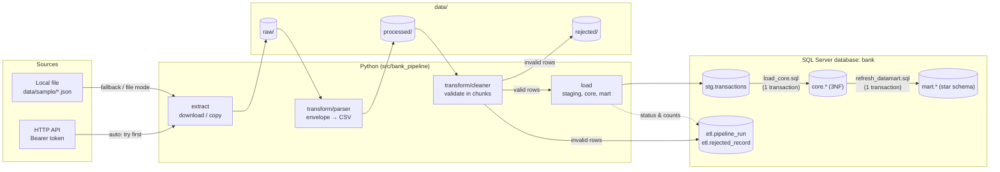
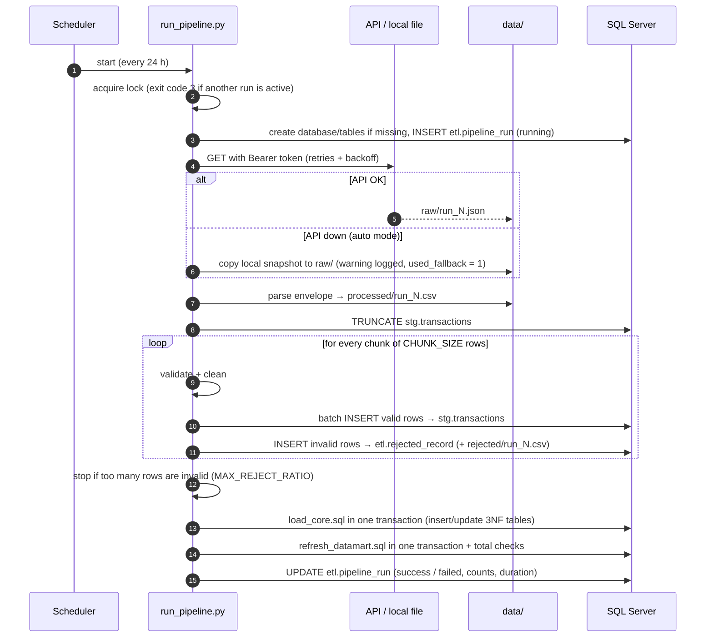
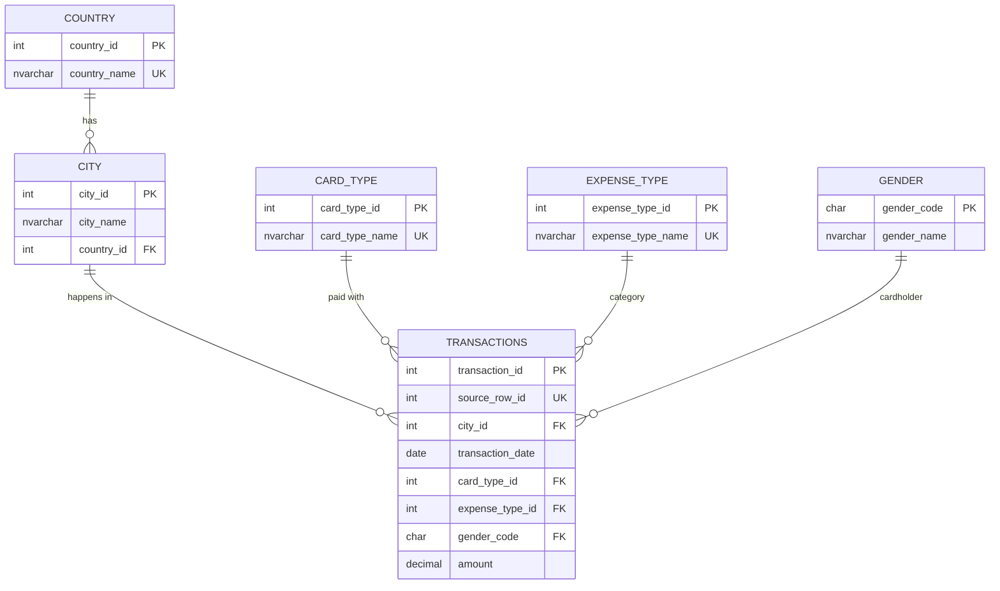
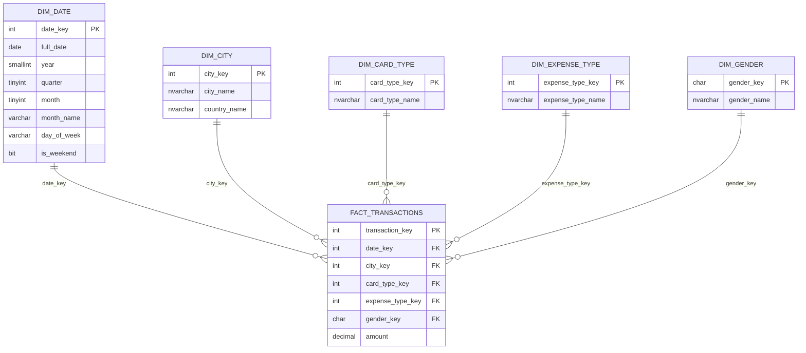
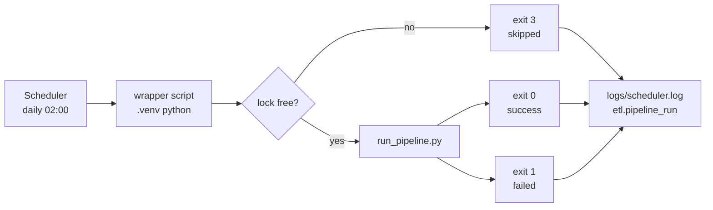

# bank-database-pipeline


An automated **ETL pipeline** that downloads bank card transactions from an authenticated HTTP API, validates and cleans them in chunks, stores them in a **normalized (3NF) Microsoft SQL Server** database and builds a **Data Mart** (star schema) for analyzing how transactions are distributed by **City**. The whole process runs with one command and is scheduled to repeat **every 24 hours** on Windows or Linux.

```text
API / local file  ──►  Extract  ──►  Parse  ──►  Clean (chunks)  ──►  Staging  ──►  Core (3NF)  ──►  Data Mart
```

> **Data source status:** the original API (`http://65.52.154.25`) was **not reachable** when this project was last checked (2026-11-12: TCP connection timeouts on ports 80 and 443). It was already failing on 2025-05-31, according to the original project's log. The pipeline handles this explicitly: in `auto` mode it logs the failure and falls back to `data/sample/transactions_snapshot.json`, which is the last real response from the API (26,052 transactions). Every run records which source it actually used. See [Known limitations](#known-limitations-and-assumptions).

---

## Table of contents

1. [Features](#features)
2. [Architecture](#architecture)
3. [ETL workflow](#etl-workflow)
4. [Project structure](#project-structure)
5. [Technologies](#technologies)
6. [Normalized relational model](#normalized-relational-model-3nf)
7. [Data Mart](#data-mart)
8. [Logging and error handling](#logging-and-error-handling)
9. [Memory and chunk processing](#memory-and-chunk-processing)
10. [Installation and configuration](#installation-and-configuration)
11. [Running the pipeline](#running-the-pipeline)
12. [Automatic scheduling (every 24 h)](#automatic-scheduling-every-24-hours)
13. [Testing](#testing)
14. [Example results](#example-results)
15. [Known limitations and assumptions](#known-limitations-and-assumptions)

---

## Features

- **Authenticated download**: Bearer token, timeout, retries with exponential backoff, size limit, and the response is streamed to disk.
- **Swappable source**: `SOURCE_MODE=api | file | auto`. The rest of the pipeline only sees a file in `data/raw/`.
- **Chunk-based transform**: pandas reads `CHUNK_SIZE` rows at a time, and all checks are vectorized.
- **Validation and cleaning**: missing values, wrong types, invalid dates, gender codes, amounts, duplicates and non-atomic `City` values. Rejected rows are saved with their reasons.
- **SQL Server load**: SQLAlchemy + pyodbc with connection pooling, parameterized queries, `fast_executemany` batch inserts, and transactions with rollback.
- **3NF model** with primary/foreign keys, unique and check constraints.
- **Star-schema Data Mart**: fact + dimension tables, City aggregates (count, %, rank, amounts) and reporting views. It is refreshed automatically after every successful load.
- **Idempotent**: running the same data again inserts 0 and updates 0 rows.
- **Centralized logging**: rotating log files, a separate error log, secrets masked, and every run saved in `etl.pipeline_run`.
- **Scheduling**: Windows Task Scheduler, systemd timer or cron, with protection against parallel runs.
- **Tests**: 38 pytest tests (unit tests + integration tests against a real SQL Server).

## Architecture



Each layer has one job:

| Module | Responsibility |
|---|---|
| `extract/` | Get the raw dataset onto disk (`api_client.py` for HTTP; local file copy and the fallback logic in `__init__.py`) |
| `transform/parser.py` | Decode the API envelope once and write a simple row-per-line CSV |
| `transform/cleaner.py` | Validate and normalize records chunk by chunk, collecting rejected rows with reasons |
| `load/staging.py` | Batch inserts into `stg.transactions` and `etl.rejected_record` |
| `load/core.py` | Run the SQL that loads the 3NF tables and refreshes the Data Mart, each in one transaction |
| `load/run_log.py` | Write one row per run to `etl.pipeline_run` |
| `database/` | Engine (connection pool), database/table setup, running `.sql` files |
| `utils/` | Logging setup, run lock, small helpers |
| `pipeline.py` | Orchestrates the steps and handles errors |

The SQL that changes data lives in plain `.sql` files under `sql/`, so it can be read and run in SSMS on its own. Python only runs the files, passes the `run_id` parameter and controls the transactions.

## ETL workflow



| Step | What happens | Output |
|---|---|---|
| **Extract** | Download with Bearer token or copy the local file. Retries, timeout and size limit for HTTP | `data/raw/run_<id>_<time>.json` |
| **Parse** | The API returns `{"status","message","json"}`, where `json` is a *string* containing pandas column-oriented JSON. It is decoded once and written row by row | `data/processed/run_<id>_<time>.csv` |
| **Transform** | Read the CSV in chunks, validate, normalize, remove duplicates | valid rows + rejected rows |
| **Load staging** | `TRUNCATE` staging, then batch inserts (`BATCH_SIZE` rows per round trip) | `stg.transactions` |
| **Load core** | Add new countries/cities/card types/expense types, update changed transactions, insert new ones | `core.*` |
| **Data Mart** | Update dimensions, rebuild the fact and aggregate tables, check totals | `mart.*` |

## Project structure

```text
bank-database-pipeline/
├── src/bank_pipeline/
│   ├── config.py              # settings from .env / environment variables
│   ├── errors.py              # custom exceptions
│   ├── pipeline.py            # runs all steps, error handling, run log
│   ├── extract/
│   │   ├── __init__.py        # get_dataset(): api / file / auto (fallback)
│   │   └── api_client.py      # HTTP download: token, timeout, retry, size limit
│   ├── transform/
│   │   ├── parser.py          # API envelope / CSV → row-per-line CSV
│   │   └── cleaner.py         # chunked validation and cleaning
│   ├── load/
│   │   ├── staging.py         # batch inserts (valid + rejected rows)
│   │   ├── core.py            # runs load_core.sql and refresh_datamart.sql
│   │   └── run_log.py         # etl.pipeline_run
│   ├── database/
│   │   ├── engine.py          # SQLAlchemy engine (pool, fast_executemany)
│   │   ├── setup.py           # create database + tables
│   │   └── sql_files.py       # run .sql files (GO batches, step row counts)
│   └── utils/
│       ├── logger.py          # rotating logs, secret masking
│       ├── lock.py            # prevents parallel runs
│       └── helpers.py         # batched(), cleanup of old files
├── sql/
│   ├── schema/                # 01-06: schemas, tables, views (safe to re-run)
│   ├── transformations/       # load_core.sql   (staging → 3NF)
│   ├── datamart/              # refresh_datamart.sql (3NF → star schema)
│   └── analysis/              # city_distribution.sql (example report queries)
├── scripts/
│   ├── run_pipeline.py        # main entry point
│   └── setup_database.py      # only create the database and tables
├── scheduler/
│   ├── windows/               # Task Scheduler: register/unregister + wrapper
│   └── linux/                 # systemd service + timer, cron example, wrapper
├── tests/                     # pytest: parser, cleaner, extract, utils, database
├── data/
│   ├── sample/transactions_snapshot.json   # last real API response (fallback)
│   └── raw/ processed/ rejected/           # generated per run (git-ignored)
├── docs/database-schema.md    # normalization and Data Mart in detail
├── documentation.md           # phase-by-phase description of the pipeline
├── logs/                      # pipeline.log, errors.log, scheduler.log (git-ignored)
├── .env.example
├── requirements.txt / requirements-dev.txt
└── pytest.ini
```

## Technologies

| Area | Used |
|---|---|
| Language | Python 3.10+ |
| Data processing | pandas (chunked `read_csv`, vectorized validation) |
| HTTP | requests (streaming download) |
| Database | Microsoft SQL Server 2019/2022 (tested on SQL Server 2022 Express) |
| DB access | SQLAlchemy 2 + pyodbc + Microsoft ODBC Driver 18 |
| Configuration | python-dotenv (`.env`) |
| Tests | pytest, `unittest.mock` |
| Scheduling | Windows Task Scheduler, systemd timer, cron |

## Normalized relational model (3NF)



The source is one flat table: `(index, City, Date, Card Type, Exp Type, Gender, Amount)`.

| Normal form | Problem in the source | Solution |
|---|---|---|
| **1NF** | `City` holds two facts, e.g. `"Delhi, India"`. The data arrives as nested column-oriented JSON | Flattened to one row per transaction. `City` split into `city_name` + `country_name`. Every row identified by `source_row_id` (the source `index`) |
| **2NF** | Partial dependencies are only possible with a composite key | Every table has a single-column primary key. The only composite *unique* key, `(city_name, country_id)` in `core.city`, has no other attributes that could depend on part of it |
| **3NF** | `source_row_id → city → country`: the country depends on the city, not on the transaction | Country moved to `core.country`, referenced from `core.city`. The gender name depends only on the gender code (`core.gender`). Card and expense types are lookup tables (no repeated strings, no update anomalies) |

The integration tests check this on the real schema. For example, `core.transactions` has no city/country text columns, it has 4 foreign keys, and the `(city, country)` pairs are unique. More details, including the functional dependencies: [docs/database-schema.md](docs/database-schema.md).

## Data Mart

The core model is built for **correct writes**. The Data Mart is built for **simple and fast reads**. It is a star schema with one fact row per transaction:



`dim_city` deliberately repeats the country name (denormalized), so City reports need one join instead of two.

**Aggregate tables and views** (main focus: distribution by `City`):

| Object | Contents |
|---|---|
| `mart.agg_city_summary` | Per city: transaction count, % of all transactions, rank, total/avg/min/max amount, % of total amount, rank by amount |
| `mart.agg_city_expense` | Per city and expense type: count, amount, % within the city |
| `mart.v_city_distribution` | City summary + **cumulative %** + total number of transactions |
| `mart.v_overview` | Totals: transactions, amount, average, number of cities, date range |
| `mart.v_city_expense` | Expense mix per city with readable names |

More queries are in [`sql/analysis/city_distribution.sql`](sql/analysis/city_distribution.sql): top cities, how many cities make up 80%, city size groups, monthly trend, and gender/card split.

**How it is refreshed:** after a successful core load, `refresh_datamart.sql` runs in one transaction. The dimension tables are referenced by foreign keys, so they are updated with `INSERT`/`UPDATE` (SQL Server does not allow `TRUNCATE` on them). The fact and aggregate tables are fully rebuilt from core and nothing references them, so they are emptied with `TRUNCATE TABLE`, which is much cheaper than `DELETE` because it doesn't log every row. Since it runs inside the transaction, an error rolls the `TRUNCATE` back too. Before the commit, Python checks that `core rows = fact rows = sum of city counts`. If they don't match, the refresh is rolled back.

## Logging and error handling

| File | Contents |
|---|---|
| `logs/pipeline.log` | Everything at `LOG_LEVEL`: start/end and duration of every step, record counts, warnings |
| `logs/errors.log` | Only `WARNING` and above, for quick checks |
| `logs/scheduler.log` | One START/END line per scheduled run, with the exit code |
| `etl.pipeline_run` | One row per run: status, source, fallback flag, extracted/valid/rejected/inserted/updated counts, duration, error |
| `etl.rejected_record` + `data/rejected/*.csv` | Every invalid record with its original values and reasons |

- Log files rotate at 5 MB and the last 10 are kept, so they cannot grow without limit.
- The token, the DB password and any `Bearer …` value are replaced with `***` before anything is written (`utils/logger.py`).
- **One bad record does not stop the run.** It is rejected, logged and stored.
- **Unsafe situations do stop the run, before the core tables are touched**: the API is down in `api` mode, the payload structure is wrong, there are no valid rows, or more than `MAX_REJECT_RATIO` (default 10%) of the rows are invalid.
- The core load and the Data Mart refresh each run in **one transaction**. On any SQL error everything in that step is rolled back and the run is marked `failed`.
- A run that was interrupted (crash, reboot) is marked as `failed` at the start of the next run.
- Exit codes: `0` success, `1` failed, `2` configuration error, `3` another run is active.

Real log of a run where the API was down (`auto` mode, run with `HTTP_TIMEOUT=5 HTTP_RETRIES=2 HTTP_BACKOFF_SECONDS=1`; long lines and paths shortened):

```text
00:40:02 | INFO     | bank_pipeline | --- Extract: started
00:40:02 | INFO     | bank_pipeline.extract.api_client | Downloading http://65.52.154.25 (attempt 1/3)
00:40:07 | WARNING  | bank_pipeline.extract.api_client | Attempt 1 failed (... Connection to 65.52.154.25 timed out. (connect timeout=5)), retrying in 1 s
00:40:08 | INFO     | bank_pipeline.extract.api_client | Downloading http://65.52.154.25 (attempt 2/3)
00:40:13 | WARNING  | bank_pipeline.extract.api_client | Attempt 2 failed (... timed out ...), retrying in 2 s
00:40:15 | INFO     | bank_pipeline.extract.api_client | Downloading http://65.52.154.25 (attempt 3/3)
00:40:20 | WARNING  | bank_pipeline.extract | API download failed: API not available after 3 attempts: ...
00:40:20 | WARNING  | bank_pipeline.extract | Falling back to the local file ...\data\sample\transactions_snapshot.json
00:40:20 | WARNING  | bank_pipeline | API was not available - this run uses the local file ...
00:40:20 | INFO     | bank_pipeline | --- Extract: finished in 18.04 s
00:40:20 | INFO     | bank_pipeline.transform.parser | Parsed 26052 records into run_3_20261112_004002.csv
00:40:22 | INFO     | bank_pipeline | Records: 26052 extracted, 26052 valid, 0 rejected
00:40:23 | INFO     | bank_pipeline.load.core | Core load: 0 inserted, 0 updated (new cities: 0, new countries: 0)
00:40:23 | INFO     | bank_pipeline.load.core | Data Mart refreshed: 26052 fact rows, 986 cities
00:40:23 | INFO     | bank_pipeline | ===== Pipeline finished successfully in 21.10 s =====
```

## Memory and chunk processing

The original script loaded the whole table into a DataFrame several times. Now:

1. **Download** is streamed to disk in 64 KB blocks, with a `MAX_DOWNLOAD_MB` limit.
2. **Parse**: the API's format (column-oriented JSON inside a string) cannot be read row by row, so it is decoded **once**, written to CSV **one row at a time** with a generator, and released.
3. **Transform** reads that CSV with `pd.read_csv(chunksize=CHUNK_SIZE, dtype=str)`. Each chunk is validated with vectorized pandas operations, inserted, and then dropped.
4. **Load** sends rows in batches of `BATCH_SIZE` with pyodbc `fast_executemany` (one round trip per batch instead of one per row). Rows are produced by a generator (`batched()`), so no extra full-size list is built.
5. Old raw/processed files are deleted after `KEEP_RUNS` runs.

Peak Python memory of the transform step, measured with `tracemalloc` (the second file is the real dataset repeated 10× with new ids, only for this measurement):

| Rows | `CHUNK_SIZE=1,000` | `5,000` (default) | `50,000` | whole file at once |
|---|---|---|---|---|
| 26,052 | 5.1 MB | 8.8 MB | 22.1 MB | 29.2 MB |
| 260,520 | 28.5 MB | 31.2 MB | 67.4 MB | 194.7 MB |

With chunks, memory grows very slowly with the dataset size. Most of what remains is the set of already-accepted ids used for the duplicate check (about 60 bytes per row). Very small chunks save little extra memory but are slower, so 5,000 is the default.

## Installation and configuration

**Requirements:** Python 3.10+, SQL Server 2019/2022 (Express or Developer edition is enough) and [Microsoft ODBC Driver 18 for SQL Server](https://learn.microsoft.com/sql/connect/odbc/download-odbc-driver-for-sql-server).

On Windows both can be installed with winget:

```powershell
winget install Microsoft.SQLServer.2022.Express
winget install Microsoft.msodbcsql.18
```

**1. Clone and create a virtual environment**

```bash
git clone https://github.com/LazarDavidovic98/bank-database-pipeline.git
cd bank-database-pipeline

python -m venv .venv
# Windows:  .venv\Scripts\activate
# Linux:    source .venv/bin/activate
pip install -r requirements-dev.txt     # or requirements.txt without the test tools
```

**2. Configure**

```bash
cp .env.example .env      # Windows: copy .env.example .env
```

The most important settings in `.env`:

| Variable | Default | Meaning |
|---|---|---|
| `SOURCE_MODE` | `auto` | `api`, `file` or `auto` (API, then local file) |
| `SOURCE_URL` / `SOURCE_TOKEN` | – / – | API address and Bearer token (**never commit the token**) |
| `LOCAL_DATA_FILE` | `data/sample/transactions_snapshot.json` | File for `file` mode and the fallback (`.json` envelope or `.csv`) |
| `DB_SERVER` | `localhost\SQLEXPRESS` | SQL Server instance |
| `DB_NAME` | `bank` | Database (created automatically) |
| `DB_TRUSTED_CONNECTION` | `true` | Windows authentication. Set `false` and fill in `DB_USER`/`DB_PASSWORD` for SQL authentication |
| `CHUNK_SIZE` / `BATCH_SIZE` | `5000` / `1000` | Rows per chunk / rows per INSERT batch |
| `MAX_REJECT_RATIO` | `0.10` | Stop the run if more invalid rows than this |
| `HTTP_TIMEOUT` / `HTTP_RETRIES` / `HTTP_BACKOFF_SECONDS` | `30` / `3` / `2` | Download behaviour |
| `LOG_LEVEL` | `INFO` | `DEBUG`, `INFO`, `WARNING`, ... |

**3. Create the database** (optional, `run_pipeline.py` does this too)

```bash
python scripts/setup_database.py
```

This creates the `bank` database and the `etl`, `stg`, `core` and `mart` schemas with all tables and views. The scripts in `sql/schema/` check `IF ... IS NULL` first, so they are safe to run again.

## Running the pipeline

```bash
python scripts/run_pipeline.py                     # uses SOURCE_MODE from .env
python scripts/run_pipeline.py --source file       # local snapshot, no API call
python scripts/run_pipeline.py --source api        # API only, fails if it is down
python scripts/run_pipeline.py --file other.csv    # load any compatible .json/.csv file
python scripts/run_pipeline.py --check-source      # only check if the API responds
```

## Automatic scheduling (every 24 hours)

Both platforms run the same wrapper logic: use the project's `.venv`, run `scripts/run_pipeline.py` (which reads `.env` itself), and write one START/END line with the exit code to `logs/scheduler.log`. Parallel runs are prevented twice: by the scheduler setting and by the pipeline's own lock file (`logs/pipeline.lock`, an OS lock that is released automatically even after a crash).



### Windows: Task Scheduler

```powershell
# register (runs every day at 02:00; choose another time with -Time "03:30")
powershell -ExecutionPolicy Bypass -File scheduler\windows\register_task.ps1

# test it right away and check the result
Start-ScheduledTask -TaskName BankDatabasePipeline
Get-ScheduledTaskInfo -TaskName BankDatabasePipeline     # LastTaskResult 0 = success
Get-Content logs\scheduler.log -Tail 5

# remove
powershell -ExecutionPolicy Bypass -File scheduler\windows\unregister_task.ps1
```

Task settings: daily trigger; **do not start a new instance if one is running**; start as soon as possible if the PC was off at 02:00; stop after 2 hours; retry a failed run twice, 30 minutes apart. The task runs as the current user. To run it while logged off, open Task Scheduler and choose *Run whether user is logged on or not*.

### Linux: systemd timer (recommended)

```bash
chmod +x scheduler/linux/run_pipeline.sh
# edit WorkingDirectory/ExecStart/User in the .service file to your path and user
sudo cp scheduler/linux/bank-pipeline.service scheduler/linux/bank-pipeline.timer /etc/systemd/system/
sudo systemctl daemon-reload
sudo systemctl enable --now bank-pipeline.timer

systemctl list-timers bank-pipeline.timer      # next run
sudo systemctl start bank-pipeline.service     # run now
journalctl -u bank-pipeline.service            # systemd log
```

`Persistent=true` catches up a missed run after the machine was off. Exit code 3 ("already running") is not treated as an error.

### Linux: cron (alternative)

```bash
crontab -e
# add (see scheduler/linux/crontab.example):
0 2 * * * /opt/bank-database-pipeline/scheduler/linux/run_pipeline.sh
```

The wrapper uses `flock -n`, so cron never starts a second copy while one is still running.

## Testing

```bash
pytest -v                  # all tests
pytest -m "not database"   # only unit tests (no SQL Server needed)
```

The tests never call the real API: HTTP is replaced by fake responses (`unittest.mock`). Database tests use a separate `bank_test` database, which is dropped and recreated for each test. They are **skipped automatically** if SQL Server is not reachable.

| File | What is tested |
|---|---|
| `test_parser.py` | API envelope → rows, CSV input, missing column, invalid JSON, error status |
| `test_cleaner.py` | Valid rows, text normalization, missing values, invalid date/gender/amount/id, future dates, duplicates within and between chunks, **same result for any chunk size** |
| `test_extract.py` | Bearer header and timeout, retry with exponential backoff, giving up after all retries, no retry on 401, size limit, `auto` fallback, `api` mode failing when the API is down |
| `test_utils.py` | Batching, run lock, secrets masked in logs, config validation, `GO` splitting |
| `test_database.py` | Full run into SQL Server, **idempotent second run**, changed and new rows (update/insert), rejected rows stored, run stopped when too many rows are invalid, run marked `failed` when the API is down, **rollback of the core load on an SQL error**, normalization checks on the real schema |

Result on SQL Server 2022 Express (Windows 11, Python 3.12):

```text
38 passed in 30.90s
```

## Example results

First run (empty database), then a second run with the same data:

```text
Run 1 OK | source: file | extracted: 26052 | valid: 26052 | rejected: 0 | inserted: 26052 | updated: 0 | cities: 986 | 4.2 s
Run 2 OK | source: file | extracted: 26052 | valid: 26052 | rejected: 0 | inserted: 0 | updated: 0 | cities: 986 | 3.46 s
```

`SELECT * FROM mart.v_overview`:

| total_transactions | total_amount | avg_amount | cities | first_date | last_date |
|---|---|---|---|---|---|
| 26,052 | 4,074,833,373.00 | 156,411.54 | 986 | 2013-10-04 | 2015-05-26 |

Top 10 cities from `mart.v_city_distribution`:

| Rank | City | Transactions | % of all | Cumulative % | Total amount |
|---|---|---|---|---|---|
| 1 | Bengaluru | 3,552 | 13.63 | 13.63 | 572,326,739 |
| 2 | Greater Mumbai | 3,493 | 13.41 | 27.04 | 576,751,476 |
| 3 | Ahmedabad | 3,491 | 13.40 | 40.44 | 567,794,310 |
| 4 | Delhi | 3,482 | 13.37 | 53.81 | 556,929,212 |
| 5 | Hyderabad | 784 | 3.01 | 56.82 | 114,493,477 |
| 6 | Chennai | 774 | 2.97 | 59.79 | 114,730,600 |
| 7 | Kolkata | 773 | 2.97 | 62.76 | 115,466,943 |
| 8 | Kanpur | 764 | 2.93 | 65.69 | 114,370,532 |
| 9 | Lucknow | 759 | 2.91 | 68.60 | 115,334,476 |
| 10 | Jaipur | 752 | 2.89 | 71.49 | 111,136,855 |

The distribution is very uneven: 4 cities account for more than half of all transactions, 72 of 986 cities make up 80%, and 904 cities have only 2–10 transactions each.

## Known limitations and assumptions

- **The original API is not available.** It could not be reached on 2026-11-12, so the API download path was tested with fake HTTP responses in the unit tests. Against the real address it was only tested as a timeout. The fallback snapshot is the last real response (originally committed as `data/dataset.json`). The `json` envelope format is taken from that file.
- The old token was committed to this repository's history before the refactoring. It was removed from the code and must be treated as **compromised**. Use a new token in `.env` if the API comes back.
- The dataset has **no customer id**, so `gender` is stored per transaction and a customer table could not be modeled.
- The dates use a two-digit year (`29-Oct-14`), read as 20xx. Dates in the future are rejected.
- `source_row_id` (the source `index`) is assumed to identify a transaction across downloads. It is used for upserts.
- Transactions that disappear from a later download are **not deleted** from core (history is kept).
- The Data Mart dimensions keep only the latest names (no history of changes, SCD type 1).
- The API envelope has to be decoded as a whole once (see [Memory](#memory-and-chunk-processing)). The download size is limited by `MAX_DOWNLOAD_MB`.
- Scheduling: the Windows wrapper (`run_pipeline.ps1`) and the run lock were tested on Windows 11, and `register_task.ps1` uses the standard `ScheduledTasks` cmdlets. The Linux systemd/cron files were not run on a Linux machine.

---

More detail: [documentation.md](documentation.md) (phase by phase) · [docs/database-schema.md](docs/database-schema.md) (normalization and Data Mart).
