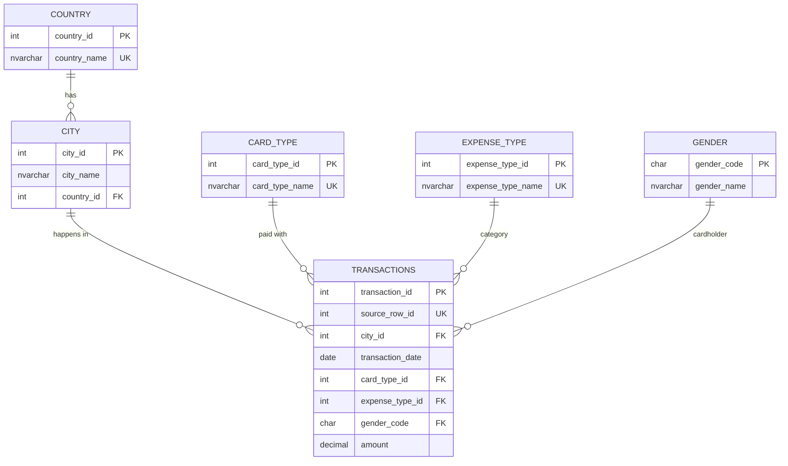

# Database schema

The database (`bank` by default) has four schemas:

| Schema | Purpose | Tables |
|---|---|---|
| `etl` | Pipeline bookkeeping | `pipeline_run`, `rejected_record` |
| `stg` | Staging: valid rows of the current run | `transactions` |
| `core` | Normalized operational model (3NF) | `country`, `city`, `card_type`, `expense_type`, `gender`, `transactions` |
| `mart` | Data Mart for reporting (star schema) | `dim_*`, `fact_transactions`, `agg_city_summary`, `agg_city_expense` + views |

## 1. Starting point

After decoding the API response, the data is one flat table with 26,052 rows:

| index | City | Date | Card Type | Exp Type | Gender | Amount |
|---|---|---|---|---|---|---|
| 0 | Delhi, India | 29-Oct-14 | Gold | Bills | F | 82475 |
| 1 | Greater Mumbai, India | 22-Aug-14 | Platinum | Bills | F | 32555 |
| 2 | Bengaluru, India | 27-Aug-14 | Silver | Bills | F | 101738 |

Profile of the snapshot: 986 distinct `City` values (all in India), 600 distinct dates (2013-10-04 to 2015-05-26), 4 card types, 6 expense types, 2 gender values, no missing values, no duplicate `index` values, and no rows that are identical apart from `index`.

Problems with this shape:

- **Non-atomic value:** `City` contains two facts (city *and* country).
- **Repetition:** `"India"` is stored 26,052 times, and each card or expense type name thousands of times. Renaming one would mean updating thousands of rows (update anomaly).
- **No enforced domain:** nothing stops a value like `Gld` or a gender `X`.
- The original version also stored the data in this flat form (`transactions`, later `new_transactions` with a separate `country` column).

## 2. Functional dependencies

Attributes after splitting `City`: `source_row_id, city_name, country_name, transaction_date, card_type, expense_type, gender, amount`.

| Dependency | Explanation |
|---|---|
| `source_row_id → city_name, country_name, transaction_date, card_type, expense_type, gender, amount` | The source `index` identifies one transaction (candidate key) |
| `(city_name, country_name)` identifies a city | The same city name could exist in two countries, so a city is identified by name **and** country |
| `city → country` | Through the city, the transaction determines the country: `source_row_id → city → country` is a **transitive** dependency |
| `gender_code → gender_name` | `F → Female`, `M → Male` |

Assumptions: there is no customer id in the data, so `gender` describes the cardholder of *that* transaction. There is no attribute that depends only on the date, card type or expense type, apart from their names.

## 3. Normalization step by step

### 1NF: atomic values, no repeating groups, unique rows

- The column-oriented JSON (`{"City": {"0": ..., "1": ...}}`) is flattened into **one row per transaction** (`transform/parser.py`).
- `City` is split into `city_name` and `country_name` (`transform/cleaner.py`). A value without a comma is rejected (`city_without_country`).
- Every row is identified by `source_row_id` (`UNIQUE` in `core.transactions`, primary key together with `run_id` in staging).

### 2NF: no partial dependencies on a composite key

A partial dependency needs a composite key. Every table in `core` uses a **single-column primary key** (`*_id` or `gender_code`), so 2NF is satisfied automatically. The only composite key is the unique constraint `(city_name, country_id)` in `core.city`, and that table has no other non-key attribute that could depend on just one part of it.

### 3NF: no transitive dependencies

- `source_row_id → city → country` is removed: the transaction stores only `city_id`, and the city stores `country_id`:
  `core.transactions.city_id → core.city.country_id → core.country`.
- `gender_code → gender_name` lives in `core.gender`, and the transaction stores only the code.
- Card types and expense types are moved to lookup tables `core.card_type` and `core.expense_type`. Strictly speaking this is not required for 3NF (the name is the only attribute), but it removes the repeated strings and the update anomaly, and it limits the values to a known list through foreign keys.

## 4. Final core model

| Table | Primary key | Foreign keys | Other constraints |
|---|---|---|---|
| `core.country` | `country_id` | – | `country_name` UNIQUE |
| `core.city` | `city_id` | `country_id → core.country` | `UNIQUE (city_name, country_id)` |
| `core.card_type` | `card_type_id` | – | `card_type_name` UNIQUE |
| `core.expense_type` | `expense_type_id` | – | `expense_type_name` UNIQUE |
| `core.gender` | `gender_code` | – | `CHECK (gender_code IN ('F','M'))` |
| `core.transactions` | `transaction_id` | `city_id`, `card_type_id`, `expense_type_id`, `gender_code` | `source_row_id` UNIQUE, `CHECK (amount > 0)` |

Result after loading the snapshot: 1 country, 986 cities, 4 card types, 6 expense types, 2 genders, 26,052 transactions.

`core.transactions` also has `loaded_run_id` (the run that inserted the row) and `updated_run_id` (the last run that changed it), so every row can be traced back to a pipeline run. Indexes exist on `city_id` and `transaction_date`, which are used in joins and filters.

**Why surrogate keys?** `source_row_id` is the natural key of a transaction and stays `UNIQUE`, because upserts use it. The integer `*_id` keys are short and stable. If a city name is corrected, only one row in `core.city` changes.

## 5. Normalized model vs. Data Mart

| | Core (3NF) | Data Mart (star) |
|---|---|---|
| Goal | Correct, consistent writes; no duplicated facts | Simple, fast reads for reports |
| Structure | Many small related tables (`country ← city ← transactions`) | One fact table + flat dimensions |
| Redundancy | None (country stored once) | On purpose (`dim_city` repeats the country name) |
| Updated by | `load_core.sql`: insert/update by `source_row_id` | `refresh_datamart.sql`: rebuilt from core after each load |
| Typical query | "Which city does transaction X belong to?" | "Share of transactions per city, ranked" |

### Star schema

- **Grain:** one row in `mart.fact_transactions` = one transaction. Measure: `amount`.
- **Dimensions:** `dim_date` (year, quarter, month, month name, day of week, weekend flag), `dim_city` (city + country, flattened), `dim_card_type`, `dim_expense_type`, `dim_gender`.
- Dimension keys are the same ids as in core, so the mart can always be rebuilt from core. Names are overwritten when they change (no history, SCD type 1).
- `date_key` is a whole number `yyyymmdd` (e.g. `20141029`).

### Aggregates for the City analysis

`mart.agg_city_summary` (one row per city):

| Column | Meaning |
|---|---|
| `transaction_count` | Number of transactions in the city |
| `percent_of_transactions` | `100 × count / total count` (window function `SUM(COUNT(*)) OVER ()`) |
| `rank_by_count` | `RANK() OVER (ORDER BY COUNT(*) DESC)` |
| `total_amount`, `avg_amount`, `min_amount`, `max_amount` | Amount statistics |
| `percent_of_amount`, `rank_by_amount` | The same for the amount |

`mart.agg_city_expense`: per city and expense type, with the share within the city.

Views: `mart.v_city_distribution` (adds a cumulative percentage and the total count), `mart.v_overview`, `mart.v_city_expense`.

### Refresh and TRUNCATE vs. DELETE

| Table | Method | Why |
|---|---|---|
| `stg.transactions` | `TRUNCATE` at the start of each run | Whole table emptied, no FK references, no identity, no history |
| `mart.dim_*` | `INSERT` new / `UPDATE` changed | Referenced by FKs from the fact table, so `TRUNCATE` is not allowed and the keys must stay the same |
| `mart.fact_transactions` | `TRUNCATE` + `INSERT ... SELECT` | Not referenced, no identity, fully derived from core |
| `mart.agg_*` | `TRUNCATE` + `INSERT ... SELECT` | Same as the fact table |
| `core.*` | never truncated or deleted | Permanent data and history |

`TRUNCATE` deallocates whole data pages instead of logging every deleted row, so it is much faster than `DELETE` for emptying a table. In SQL Server it can be rolled back inside a transaction, which is why the whole mart refresh runs in one transaction.
